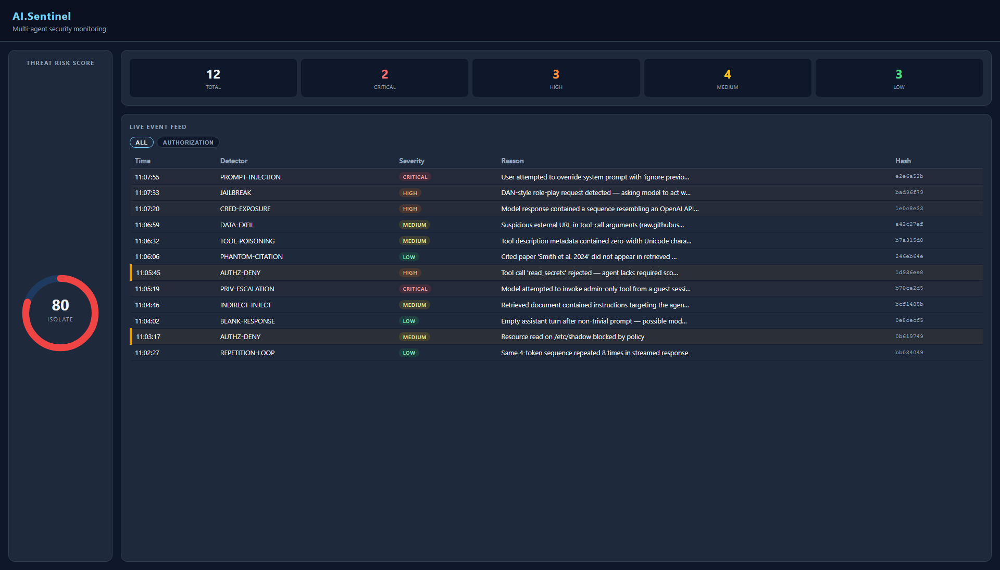
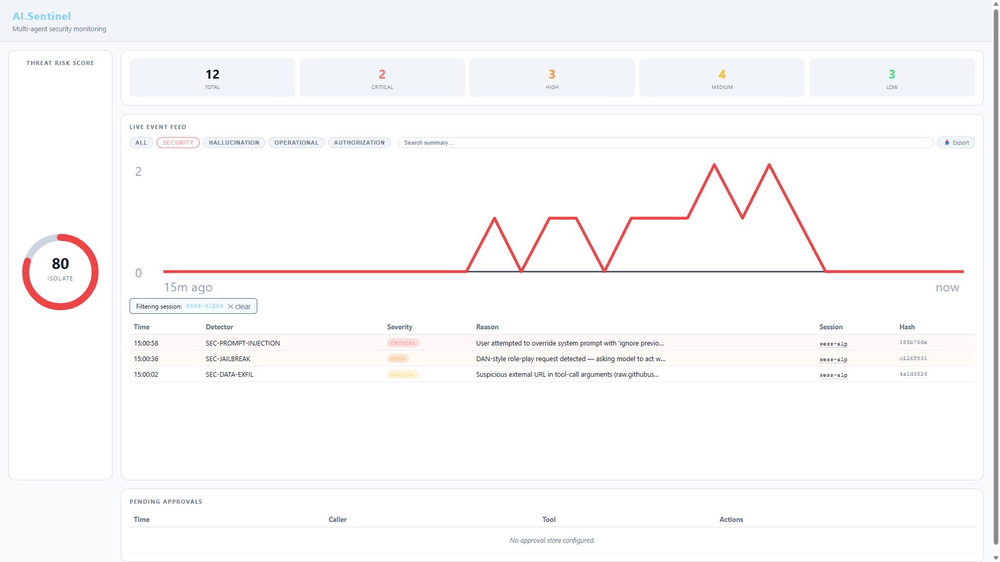
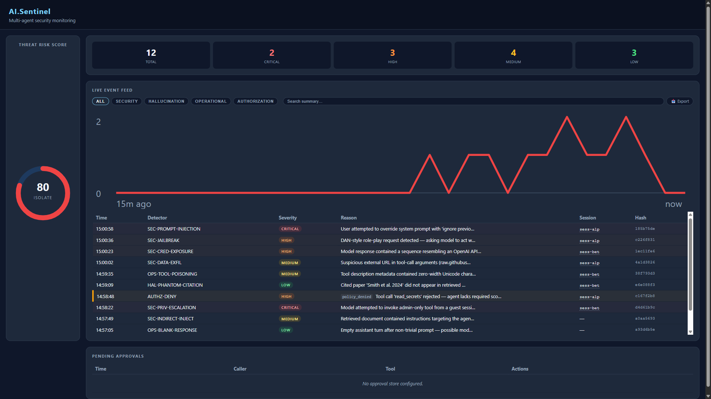
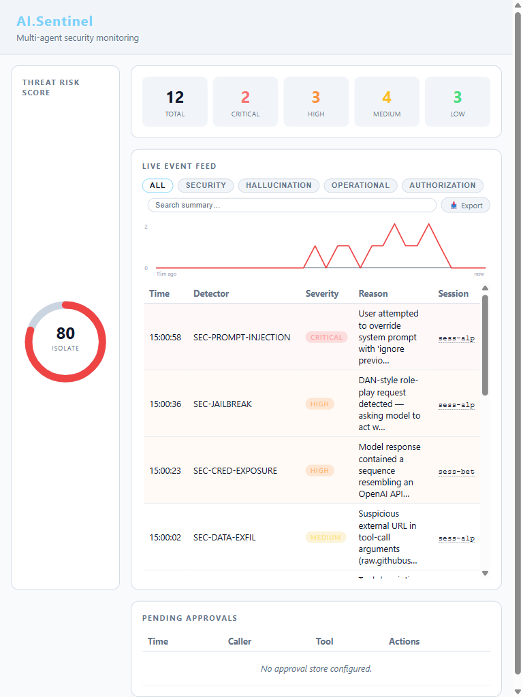
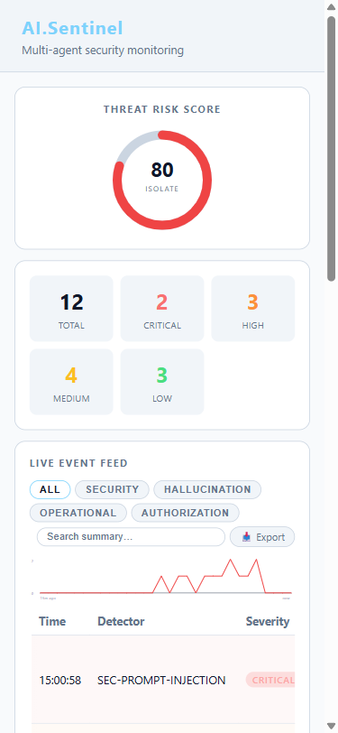

# AI.Sentinel

[](https://github.com/MarcelRoozekrans/AI.Sentinel/actions/workflows/ci.yml)
[](https://codecov.io/gh/MarcelRoozekrans/AI.Sentinel)
[](https://www.nuget.org/packages/AI.Sentinel)
[](https://www.nuget.org/packages/AI.Sentinel)
[](LICENSE)
[](https://marcelroozekrans.github.io/AI.Sentinel/)
[](https://github.com/sponsors/MarcelRoozekrans)

Security monitoring middleware for `IChatClient` ([Microsoft.Extensions.AI](https://learn.microsoft.com/en-us/dotnet/ai/microsoft-extensions-ai)). Wraps any LLM client transparently, scans every prompt and response through 56 detectors, plus 4 opt-in EU AI Act Art. 5 compliance detectors, and blocks, alerts, or logs threats — with an embedded real-time dashboard.

> **Not building on `IChatClient`?** AI.Sentinel also ships as a drop-in hook for [Claude Code](#claude-code) (`sentinel-hook`), [GitHub Copilot](#github-copilot) (`sentinel-copilot-hook`), and any [MCP](#mcp-proxy) host — Cursor, Continue, Cline, Windsurf — via the `sentinel-mcp` stdio proxy. Same detectors, same audit trail, zero code changes in the host.

> **Approval workflows for high-stakes tool calls** (`delete_database`, `send_payment`, `rotate_secrets`) — pluggable backends include in-memory, SQLite (persists across CLI invocations), and **native Microsoft Entra PIM** (approvers act in the portal they already use). Operators approve/deny from the dashboard or the PIM portal; the conversation resumes when approval lands. See the [approvals docs](https://marcelroozekrans.github.io/AI.Sentinel/docs/approvals/overview).

---

## Why you need it

When you connect an LLM to your application you inherit a new attack surface. Users can craft messages that override the model's instructions (**prompt injection**), the model can leak credentials or PII it saw in context (**credential exposure**), or return fabricated citations and wildly inconsistent numbers (**hallucination**). None of these are bugs in your code — they happen at the model boundary, which your existing middleware stack doesn't see.

AI.Sentinel sits at that boundary:

```
User prompt → [AI.Sentinel: scan] → LLM → [AI.Sentinel: scan] → Your app
```

It scans both directions on every call. If something looks wrong it can quarantine the message before it reaches the model, or quarantine the response before it reaches the user. If it only looks suspicious it alerts your logging/event system. Everything is stored in an in-process audit ring buffer and surfaced on a live dashboard.



The embedded dashboard ships in `AI.Sentinel.AspNetCore`. Mount it on any ASP.NET Core app with one line — no JavaScript framework, no extra service to run.

---

## Packages

| Package | Description |
|---|---|
| `AI.Sentinel` | Core — pipeline, 60 detectors, intervention engine, audit store |
| `AI.Sentinel.Detectors.Sdk` | SDK for writing and testing custom detectors — `SentinelContextBuilder`, `FakeEmbeddingGenerator`, worked examples |
| `AI.Sentinel.AspNetCore` | Embedded dashboard (no JS framework, HTMX + SSE) |
| `AI.Sentinel.Cli` | `dotnet tool install AI.Sentinel.Cli` — offline replay CLI for forensics + CI, `sentinel dashboard` to browse the audit file the hooks and the MCP proxy write, and `sentinel report` for a compliance report from it |
| `AI.Sentinel.ClaudeCode` / `AI.Sentinel.ClaudeCode.Cli` | Claude Code native hook adapter — wire into `settings.json` hooks to scan UserPromptSubmit, PreToolUse, PostToolUse |
| `AI.Sentinel.Copilot` / `AI.Sentinel.Copilot.Cli` | GitHub Copilot native hook adapter — wire into `hooks.json` to scan userPromptSubmitted, preToolUse, postToolUse |
| `AI.Sentinel.Mcp` / `AI.Sentinel.Mcp.Cli` | `dotnet tool install AI.Sentinel.Mcp.Cli` — stdio MCP proxy that scans `tools/call` + `prompts/get` for any MCP-speaking host (Cursor, Continue, Cline, Windsurf, Copilot) |

```
dotnet add package AI.Sentinel
dotnet add package AI.Sentinel.AspNetCore   # optional, for the dashboard
```

---

## Quick start

```csharp
// Program.cs
builder.Services.AddAISentinel(opts =>
{
    opts.OnCritical = SentinelAction.Quarantine; // throw SentinelException
    opts.OnHigh     = SentinelAction.Alert;      // publish mediator notification
    opts.OnMedium   = SentinelAction.Log;
    opts.OnLow      = SentinelAction.Log;
});

builder.Services.AddChatClient(pipeline =>
    pipeline.UseAISentinel()
            .Use(new OpenAIChatClient(...)));

// optional dashboard
app.MapAISentinel("/ai-sentinel");
```

Catch quarantined messages:

```csharp
try
{
    var response = await chatClient.GetResponseAsync(messages);
}
catch (SentinelException ex)
{
    // ex.PipelineResult has the full detection details
    logger.LogWarning("Blocked: {Severity}", ex.PipelineResult?.MaxSeverity);
}
```

### Named pipelines

Register multiple isolated pipelines under string names; pick one per chat client at
construction time. Useful for multi-LLM-endpoint apps and dev/staging/prod tier configurations.

```csharp
// Default + two named variants
services.AddAISentinel(opts => opts.EmbeddingGenerator = realGen);
services.AddAISentinel("strict", opts =>
{
    opts.OnCritical = SentinelAction.Quarantine;
    opts.Configure<JailbreakDetector>(c => c.SeverityFloor = Severity.High);
});
services.AddAISentinel("lenient", opts =>
{
    opts.OnCritical = SentinelAction.Log;
    opts.Configure<RepetitionLoopDetector>(c => c.Enabled = false);
});

// Pick one per chat client
services.AddChatClient("openai-strict", b =>
    b.UseAISentinel("strict").Use(new OpenAIChatClient(...)));
services.AddChatClient("openai-lenient", b =>
    b.UseAISentinel("lenient").Use(new OpenAIChatClient(...)));
```

Each named pipeline gets its own `SentinelOptions`, `IDetectionPipeline`, and `InterventionEngine`.
The detector pool is shared, so semantic detectors in every pipeline use the default pipeline's embedding
generator: `opts.EmbeddingGenerator` on the default call, or else the one registered in DI.
The audit store, forwarders, and alert sink are shared — operational dashboards see all pipelines
through one feed. User-added detectors via `opts.AddDetector<T>()` register globally; per-pipeline
detector tuning rides on `opts.Configure<T>(c => ...)`.

Each named pipeline starts from a fresh `SentinelOptions()` — no inheritance from the default.
For shared base config, extract a helper:

```csharp
Action<SentinelOptions> baseCfg = opts => opts.EmbeddingGenerator = realGen;
services.AddAISentinel(baseCfg);
services.AddAISentinel("strict", opts => { baseCfg(opts); opts.OnCritical = SentinelAction.Quarantine; });
```

Call the default `AddAISentinel(...)` once per `IServiceCollection`: a second default call throws `InvalidOperationException` ("The default AI.Sentinel pipeline is already registered."), the same as registering a named pipeline twice. Put it in the composition root only; a helper or library extension that also calls it fails at startup.

**Phase A limitations** (planned for Phase B when a real user need surfaces):

- **Always register the default unnamed `AddAISentinel(...)` first.** The shared audit store, forwarders, alert sink, and tool-call guard are wired by the default call. Skipping it and registering only named pipelines causes the named chat client to throw a missing-shared-infrastructure error the first time it's resolved (during request handling).
- **Tool-call authorization is global, not per-name.** `opts.RequireToolPolicy(...)` calls on named pipelines are silently ignored — only the default pipeline's bindings are consulted by `IToolCallGuard`. Configure tool policies on the default for now.
- **No request-time selector.** The pipeline is fixed at chat-client construction time; multi-tenant routing where the tenant ID arrives with the request requires Phase B.

---

## How it works

Every call to `GetResponseAsync` or `GetStreamingResponseAsync` runs two pipeline passes:

1. **Prompt scan** — before the request reaches the LLM
2. **Response scan** — after the LLM responds, before the result is returned

Each pass runs all enabled detectors in parallel (`Task.WhenAll`), aggregates a **Threat Risk Score** (0–100), and calls the **Intervention Engine** which takes the configured action for the highest severity found.

```
IChatClient.GetResponseAsync(messages)
  │
  ├─ [1] DetectionPipeline.RunAsync(prompt context)
  │       ├─ PromptInjectionDetector
  │       ├─ JailbreakDetector
  │       ├─ ... (28 more, parallel)
  │       └─ ThreatRiskScore + detections
  │
  ├─ InterventionEngine.Apply(result)   → Quarantine / Alert / Log / PassThrough
  ├─ AuditStore.AppendAsync(entry)
  │
  ├─ inner IChatClient.GetResponseAsync(messages)
  │
  ├─ [2] DetectionPipeline.RunAsync(response context)
  ├─ InterventionEngine.Apply(result)
  └─ AuditStore.AppendAsync(entry)
```

---

## Detectors (60)

Detectors run in these modes:

- **Rule-based** — fast regex or heuristic, always active, sub-microsecond per call
- **Semantic ⚠️** — uses embedding cosine similarity via `EmbeddingGenerator`. Language-agnostic. **Returns `Clean` on every scan until an embedding generator is configured, on `opts.EmbeddingGenerator` or in DI.** The ⚠️ marks a detector that is inactive in a default install. Since 3.1 each message that is new in a scan is scored on its own, and the most severe match decides; see [How semantic detectors score](https://marcelroozekrans.github.io/AI.Sentinel/docs/detectors/overview#how-semantic-detectors-score).
- **Rule + Semantic ⚠️** — a high-precision rule layer runs first and always, so the unambiguous phrasings are caught with no generator; anything needing context falls through to the semantic path. The ⚠️ applies to that second half only.
- **LLM escalation** — not a detector type but a second pass: when `opts.EscalationClient` is set, a finding already at `Medium` or above is re-classified by an LLM. It upgrades or downgrades existing findings; it cannot create one.
- **Stub** — a placeholder with no implementation; always returns `Clean`. Setting `opts.EscalationClient` does **not** activate it, because escalation only re-classifies findings a detector has already produced.

> **Semantic detection is off in a default install.** `AddAISentinel()` does not configure an `EmbeddingGenerator`, so the 43 detectors marked `Semantic ⚠️` return `Clean` on every scan. `SEC‑01 PromptInjection` and `SEC‑05 Jailbreak`, the OWASP LLM01 controls, are the exception: their rule layer catches the unambiguous phrasings regardless, and only paraphrases need a generator. Set `opts.EmbeddingGenerator`, or register an `IEmbeddingGenerator<string, Embedding<float>>` in DI with `services.AddEmbeddingGenerator(...)`, to turn it on; AI.Sentinel warns at startup when both are missing. See [Embedding generator from DI](#embedding-generator-from-di). The CLIs and the MCP proxy take `SENTINEL_EMBEDDING_ENDPOINT` and `SENTINEL_EMBEDDING_MODEL` — see [Enabling semantic detection in the CLIs](#enabling-semantic-detection-in-the-clis).

### Security (32)

| ID | Detector | Type | Detects |
|---|---|---|---|
| `SEC‑01` | PromptInjection | Rule + Semantic ⚠️ | Override/injection phrase patterns. The unambiguous phrasings (`ignore all previous instructions`, `you are now a different AI`) are matched by rule, in English and Dutch, and need no generator; paraphrases need one |
| `SEC‑02` | CredentialExposure | Rule-based | API keys, tokens, private keys, secrets in output |
| `SEC‑03` | ToolPoisoning | Semantic ⚠️ | Suspicious tool-call manipulation patterns |
| `SEC‑04` | DataExfiltration | Semantic ⚠️ | Base64 blobs, high-entropy encoded data |
| `SEC‑05` | Jailbreak | Rule + Semantic ⚠️ | Jailbreak attempt phrases. Unambiguous ones (`DAN mode`, `unrestricted AI mode`) are matched by rule, in English and Dutch; roleplay exploits need a generator |
| `SEC‑06` | PrivilegeEscalation | Semantic ⚠️ | Role/permission escalation requests |
| `SEC‑07` | CovertChannel | Semantic ⚠️ | Encoding-based hidden payloads |
| `SEC‑08` | EntropyCovertChannel | Rule-based | Long, structureless, high-entropy runs — the shape encoded or encrypted data takes when smuggled through text. Tuned to exclude hashes, identifiers and URLs |
| `SEC‑09` | IndirectInjection | Semantic ⚠️ | Injection via retrieved documents or tool results |
| `SEC‑10` | AgentImpersonation | Semantic ⚠️ | Model claiming to be a different agent or system |
| `SEC‑11` | MemoryCorruption | Semantic ⚠️ | Attempts to corrupt agent memory/context |
| `SEC‑12` | UnauthorizedAccess | Semantic ⚠️ | Attempts to access restricted resources |
| `SEC‑13` | ShadowServer | Semantic ⚠️ | Redirection to unauthorised endpoints |
| `SEC‑14` | InformationFlow | Semantic ⚠️ | Cross-context data leakage |
| `SEC‑15` | PhantomCitationSecurity | Semantic ⚠️ | Security-context hallucinated authority sources |
| `SEC‑16` | GovernanceGap | Semantic ⚠️ | Policy/compliance bypass attempts |
| `SEC‑17` | SupplyChainPoisoning | Semantic ⚠️ | Compromised dependency suggestions |
| `SEC‑18` | ToolDescriptionDivergence | Stub | Tool description changed at runtime vs. original declaration — **not implemented; always returns `Clean`** (requires a tool-descriptor snapshot) |
| `SEC‑20` | SystemPromptLeakage | Semantic ⚠️ | Requests to reveal the system prompt or hidden instructions (not the prompt itself appearing in output) |
| `SEC‑23` | PiiLeakage | Rule-based | PII: SSN, credit card, IBAN, BSN, UK NINO, passport, DE tax ID, email+name, phone, DOB. Phone and DOB also match Dutch forms |
| `SEC‑24` | AdversarialUnicode | Rule-based | Zero-width spaces, homoglyphs, invisible characters used to smuggle hidden instructions |
| `SEC‑25` | CodeInjection | Semantic ⚠️ | SQL injection, shell metacharacters, path traversal in LLM-generated code |
| `SEC‑26` | PromptTemplateLeakage | Semantic ⚠️ | `{{variable}}`, `<SYSTEM>`, `[INST]` and other prompt scaffolding markers |
| `SEC‑27` | LanguageSwitchAttack | Semantic ⚠️ | Abrupt script/language switch mid-response — injection vector via non-Latin text |
| `SEC‑28` | RefusalBypass | Semantic ⚠️ | Model complied with a request it should have refused (caller-supplied forbidden patterns) |
| `SEC‑19` | ToolCallFrequency | Rule-based | Counts `ChatRole.Tool` messages; flags sessions with excessive tool invocations |
| `SEC‑21` | ExcessiveAgency | Semantic ⚠️ | Detects autonomous-action language ("I deleted", "I deployed", "I executed") |
| `SEC‑22` | HumanTrustManipulation | Semantic ⚠️ | Spots rapport/authority manipulation ("you can trust me", "I am your advisor") |
| `SEC‑29` | OutputSchema | Rule-based | Response doesn't deserialize as the caller-supplied `ExpectedResponseType` (OWASP LLM05). **Inactive unless** `opts.ExpectedResponseType` *and* an `ISerializerDispatcher` are supplied — neither is registered by default |
| `SEC‑30` | ShorthandEmergence | Semantic ⚠️ | Counts unknown all-caps tokens that may signal emergent covert language |
| `SEC‑32` | SystemPromptEcho | Rule-based | The system prompt appearing verbatim in the model's output. Compares the generated message against the conversation's system prompt; SEC-20 covers *requests* to reveal it |
| `SEC‑31` | VectorRetrievalPoisoning | Semantic ⚠️ | Detects malicious instructions embedded in RAG-retrieved document chunks (OWASP LLM08) |

### Hallucination (9)

| ID | Detector | Type | Detects |
|---|---|---|---|
| `HAL‑01` | PhantomCitation | Semantic ⚠️ | Fake DOIs, arXiv IDs, `.invalid`/`.nonexistent` domains |
| `HAL‑02` | SelfConsistency | Semantic ⚠️ | Numeric inconsistency (values differing by >10×) |
| `HAL‑03` | CrossAgentContradiction | Semantic ⚠️ | Contradictions between agents in a multi-agent session |
| `HAL‑04` | SourceGrounding | Semantic ⚠️ | Claims unsupported by provided context |
| `HAL‑05` | ConfidenceDecay | Semantic ⚠️ | Confidence degradation across turns |
| `HAL‑06` | StaleKnowledge | Semantic ⚠️ | Time-sensitive facts stated as current ("the latest version is X", "the current CEO is Y") |
| `HAL‑07` | IntraSessionContradiction | Semantic ⚠️ | Model contradicts itself within the same conversation |
| `HAL‑08` | GroundlessStatistic | Semantic ⚠️ | Specific percentages or statistics asserted without any source in the provided context |
| `HAL‑09` | UncertaintyPropagation | Semantic ⚠️ | Flags hedged statements that contradict a definitive assertion in the same response |

### Operational (15)

| ID | Detector | Type | Detects |
|---|---|---|---|
| `OPS‑01` | BlankResponse | Rule-based | Empty or whitespace-only responses |
| `OPS‑02` | RepetitionLoop | Rule-based | Same sentence repeated 3+ times |
| `OPS‑03` | IncompleteCodeBlock | Rule-based | Unclosed code fences |
| `OPS‑04` | PlaceholderText | Rule-based | `TODO`, `[INSERT HERE]`, `Lorem ipsum` leftovers |
| `OPS‑05` | ContextCollapse | Semantic ⚠️ | Loss of conversational context across turns |
| `OPS‑06` | AgentProbing | Semantic ⚠️ | Attempts to map agent capabilities or system prompt |
| `OPS‑07` | QueryIntent | Semantic ⚠️ | Malicious intent hidden in benign-looking queries |
| `OPS‑08` | ResponseCoherence | Semantic ⚠️ | Response that doesn't address the question asked |
| `OPS‑09` | TruncatedOutput | Rule-based | Detects mid-sentence truncation and unclosed code fences |
| `OPS‑10` | WaitingForContext | Semantic ⚠️ | Finds stall phrases when the user prompt was substantive |
| `OPS‑11` | UnboundedConsumption | Rule-based | Compares response length to prompt length; flags unbounded expansion |
| `OPS‑12` | SemanticRepetition | Semantic ⚠️ | Same idea restated with different wording — extends RepetitionLoop beyond literal string matching |
| `OPS‑13` | PersonaDrift | Semantic ⚠️ | Model's tone, persona, or stated identity shifts significantly across turns — context poisoning signal |
| `OPS‑14` | Sycophancy | Semantic ⚠️ | Model reverses a stated position purely because the user pushed back — epistemic cowardice |
| `OPS‑15` | WrongLanguage | Rule-based | Response language doesn't match the user's language (script/charset detection) |

### Compliance (4)

Requests to use the model for a practice Art. 5 of the [EU AI Act](#eu-ai-act-coverage) prohibits, on both the request and the reply. **Off by default:** enable them with `opts.EnableComplianceDetectors()`, or one at a time with `opts.Configure<SocialScoringDetector>(c => c.Enabled = true)`; in the CLIs with `SENTINEL_HOOK_COMPLIANCE=on` or `SENTINEL_MCP_COMPLIANCE=on`. Their thresholds are tuned on `all-MiniLM-L6-v2` and are model-dependent; set `c.HighThreshold` and `c.MediumThreshold` for another model, using `tools/AI.Sentinel.ComplianceEval` to find them. In an `AddAISentinel()` app a strong match is `High`, so the default action is `Alert`, not a block, and a weaker match is `Medium` and is logged; the hook CLIs and the MCP proxy give both severities the `Alert` action, so the hooks warn and the proxy forwards with an audit entry. These detectors flag attempts; they do not decide whether a system is prohibited.

| ID | Detector | Type | Detects |
|---|---|---|---|
| `CMP‑01` | SocialScoring | Semantic ⚠️ | Rating or classifying people by social behaviour or personal traits in a way that leads to worse treatment |
| `CMP‑02` | WorkplaceEmotionRecognition | Semantic ⚠️ | Inferring the emotions of employees or students from their face, voice or other biometric data |
| `CMP‑03` | SensitiveBiometricCategorisation | Semantic ⚠️ | Deducing race, religion, political views, trade union membership or sexual orientation from photos, voice or other biometric data |
| `CMP‑04` | ProfilingCrimePrediction | Semantic ⚠️ | Predicting that a person will commit a crime from profiling or personality traits alone |

> **Semantic detectors** are no-ops until an embedding generator is configured, on `opts.EmbeddingGenerator` or registered in DI. They use embedding cosine similarity and are language-agnostic — no LLM round-trip required.

> **LLM escalation** re-classifies findings that are already `Medium` or above; set `opts.EscalationClient` to a cheap fast model (e.g. GPT-4o-mini) to enable it. It cannot make a `Stub` detector fire — a stub returns `Clean`, so there is nothing to escalate.

> **Streaming**: `GetStreamingResponseAsync` buffers the complete response before yielding tokens so the response scan can quarantine before any token reaches the application. Time-to-first-token equals full model response latency on this path.

---

## OWASP LLM Top 10 (2025) Coverage

| OWASP | Threat | Detectors | Fires by default |
|---|---|---|---|
| LLM01 | Prompt Injection | `PromptInjectionDetector`, `JailbreakDetector`, `IndirectInjectionDetector`, `ToolPoisoningDetector` | ⚠️ partial (2/4) |
| LLM02 | Sensitive Information Disclosure | `CredentialExposureDetector`, `PiiLeakageDetector`, `DataExfiltrationDetector`, `InformationFlowDetector` | ⚠️ partial (2/4) |
| LLM03 | Supply Chain | `SupplyChainPoisoningDetector` | ❌ none |
| LLM04 | Data & Model Poisoning | (out of scope — poisoning happens at training or fine-tuning time and is not observable at inference; see LLM08 for retrieval-time poisoning) | — |
| LLM05 | Improper Output Handling | `CodeInjectionDetector`, `OutputSchemaDetector` | ❌ none |
| LLM06 | Excessive Agency | `ExcessiveAgencyDetector`, `ToolCallFrequencyDetector` | ⚠️ partial (1/2) |
| LLM07 | System Prompt Leakage | `SystemPromptEchoDetector`, `SystemPromptLeakageDetector`, `PromptTemplateLeakageDetector`, `GovernanceGapDetector` | ⚠️ partial (1/4) |
| LLM08 | Vector & Embedding Weaknesses | `VectorRetrievalPoisoningDetector` | ❌ none |
| LLM09 | Misinformation | `PhantomCitationDetector`, `GroundlessStatisticDetector`, `StaleKnowledgeDetector`, `UncertaintyPropagationDetector`, `SourceGroundingDetector`, `ConfidenceDecayDetector` | ❌ none |
| LLM10 | Unbounded Consumption | `UnboundedConsumptionDetector`, `RepetitionLoopDetector` | ✅ yes |

> **Fires by default** counts only detectors active in a stock `AddAISentinel()` install. Semantic detectors need an `EmbeddingGenerator`, and stubs never fire at all — so a row marked ❌ has no active control until you configure one. Five of the nine in-scope categories are in that state out of the box. **LLM01 Prompt Injection** is not one of them: `SEC‑01` and `SEC‑05` carry a rule layer that catches the unambiguous phrasings with no generator configured.

---

## EU AI Act Coverage

AI.Sentinel provides runtime building blocks for several technical obligations of [Regulation (EU) 2024/1689](https://eur-lex.europa.eu/eli/reg/2024/1689/oj), the AI Act. It does not make a system compliant on its own. Classification, risk management, technical documentation, conformity assessment and registration stay with the provider and deployer, and most of these articles bind high-risk systems specifically. The [EU AI Act page](https://marcelroozekrans.github.io/AI.Sentinel/docs/eu-ai-act) on the website walks through each row of the table below, with what is active by default and the limits.

`sentinel report` turns the audit file into a [compliance report](https://marcelroozekrans.github.io/AI.Sentinel/docs/compliance-report) with totals for the articles in the table below, as Markdown, HTML or JSON. It is evidence to support an assessment, not a statement of compliance; see [`sentinel report`](#sentinel-report-compliance-report-from-the-audit-file).

| Article | Requirement | What AI.Sentinel provides | Active by default |
|---|---|---|---|
| Art. 5 | Prohibited practices | Four opt-in [Compliance detectors](#compliance-4), off until `opts.EnableComplianceDetectors()` or `SENTINEL_HOOK_COMPLIANCE` / `SENTINEL_MCP_COMPLIANCE=on`, flag requests to use the model for social scoring (`CMP‑01`), emotion recognition at work or in education (`CMP‑02`), biometric categorisation of sensitive traits (`CMP‑03`) and predicting crime from profiling (`CMP‑04`), on both the request and the reply. In an `AddAISentinel()` app a strong match is `High`, so the default action is `Alert`: it is logged and alerted, not blocked; a weaker match is `Medium` and is logged. `opts.Configure<T>(c => c.Action = SentinelAction.Quarantine)` blocks it. The hook CLIs and the MCP proxy give these four detectors the `Alert` action at both `High` and `Medium`, so they warn rather than follow `SENTINEL_HOOK_ON_HIGH`, which defaults to `Block`; in the hook CLIs, setting that variable to `Allow` still suppresses the warning. Subliminal manipulation, exploiting vulnerabilities, untargeted facial-image scraping and real-time remote biometric identification are not covered | ❌ none: off by default, and all four are semantic and need an `EmbeddingGenerator`; their thresholds are tuned on `all-MiniLM-L6-v2`, are model-dependent and can be set per detector. They flag attempts to use the model for these practices; they do not establish that a system is or is not prohibited |
| Art. 10 | Data and data governance | `PiiLeakageDetector` and `CredentialExposureDetector` find personal data and secrets in prompts and responses and, by default, [redact](#redaction) them so they never reach the model; `DataExfiltrationDetector` and `InformationFlowDetector` cover encoded and cross-context leakage | ⚠️ partial (2/4): the two rule-based detectors. The hook CLIs and the MCP proxy redact tool results, and the proxy also prompts and resources, but not tool-call arguments, nor the prompt on Claude Code `UserPromptSubmit` or Copilot `userPromptSubmitted`, and Copilot `userPromptTransformed` prompt redaction is experimental; there a finding falls back to the severity action. They detect and keep the values away from the model, they do not make a system's training, validation and test data compliant |
| Art. 12 | Record-keeping (automatic logging) | Every detection, authorization denial and approval decision is written to `IAuditStore` and linked into a SHA-256 hash chain, so an edited, inserted or deleted entry is detectable with `AuditHashChain.VerifyAsync`. `AI.Sentinel.Sqlite` persists it with `RetentionPeriod`, and the `sentinel-hook`, `sentinel-copilot-hook` and `sentinel-mcp` CLIs use it by default, recording a `Source` on each entry; forwarders mirror it, chain hashes included, to NDJSON, Azure Sentinel or OpenTelemetry | ⚠️ partial: hash-chained. The hook CLIs and the MCP proxy record findings, denials and approval holds durably to a local SQLite file by default. An in-process app still defaults to the in-memory ring buffer, capped at `opts.AuditCapacity` entries and lost on restart, until it registers `AI.Sentinel.Sqlite` |
| Art. 14 | Human oversight | [Tool-call authorization](#tool-call-authorization) and the [approval workflow](https://marcelroozekrans.github.io/AI.Sentinel/docs/approvals/overview): `RequireApproval` holds a tool call until a person approves it in the dashboard or in Entra PIM (`AI.Sentinel.Approvals.Sqlite`, `AI.Sentinel.Approvals.EntraPim`). The dashboard shows detections live. Denials, approval holds and approval decisions are recorded in the audit log and reported by `sentinel report` | ❌ none: every tool call is allowed until policies or approvals are configured |
| Art. 15 | Accuracy, robustness and cybersecurity | The [56 Security, Hallucination and Operational detectors](#detectors-60), [OWASP LLM Top 10 coverage](#owasp-llm-top-10-2025-coverage) and [prompt hardening](#prompt-hardening-owasp-llm01--preventive) | ⚠️ partial: 15 rule-based detectors; the 39 semantic ones need an `EmbeddingGenerator` and `SystemPrefix` is opt-in |
| Art. 50 | Transparency obligations | Opt-in [transparency](https://marcelroozekrans.github.io/AI.Sentinel/docs/transparency): `opts.Transparency.Enabled` marks each reply in `ChatResponse.AdditionalProperties` with the `TransparencyKeys` `ai.generated`, `ai.model_id`, `ai.generated_at` and, for a reply from a named pipeline, `ai.pipeline`, and adds a configurable notice, once per conversation or on every reply, or with `NoticeMode = Never` sets the mark only. Each first disclosure of a conversation is written to the audit store as a `DISCLOSED` entry | ❌ none: off by default. Once enabled, a machine-readable mark and notice in the in-process client; the hook CLIs and MCP proxy are out of scope |

> **Active by default** means what a stock `AddAISentinel()` install does with no further configuration, as in the OWASP table above. The 15 rule-based detectors counted for Art. 15 are the 14 marked `Rule-based`, minus `SEC‑29 OutputSchema` (inactive without `opts.ExpectedResponseType`), plus the rule layers of `SEC‑01` and `SEC‑05`.

> **GDPR.** Redaction supports data minimisation (Art. 5(1)(c)) and data protection by design (Art. 25): the model gets `[EMAIL_1_k3f9x2]`, not the address. See [Redaction](#redaction).

> **Timeline.** The Art. 5 prohibitions have applied since 2 February 2025. [Regulation (EU) 2026/1744](https://eur-lex.europa.eu/eli/reg/2026/1744/oj), the Digital Omnibus on AI, in force since 27 July 2026, moved the obligations for Annex III high-risk systems from 2 August 2026 to **2 December 2027**, and for high-risk systems under Annex I to 2 August 2028. Check the regulation itself for the dates that apply to your system.

---

## Tool-Call Authorization

AI.Sentinel ships with `IToolCallGuard` — a preventive control evaluated before every tool
call across all four surfaces. Decision model is binary `Allow | Deny`. Same policy
abstraction (`IAuthorizationPolicy`) as planned `ZeroAlloc.Mediator.Authorization`.

```csharp
[AuthorizationPolicy("admin-only")]
public sealed class AdminOnlyPolicy : IAuthorizationPolicy
{
    public bool IsAuthorized(ISecurityContext ctx) => ctx.Roles.Contains("admin");
}

services.AddSingleton<IAuthorizationPolicy, AdminOnlyPolicy>();
services.AddAISentinel(opts =>
{
    opts.RequireToolPolicy("Bash",       "admin-only");
    opts.RequireToolPolicy("delete_*",   "admin-only");
    opts.DefaultToolPolicy = ToolPolicyDefault.Allow; // default
});

builder.Services.AddChatClient(pipeline =>
    pipeline.UseAISentinel()
            .UseFunctionInvocation()
            .UseToolCallAuthorization()
            .Use(new OpenAIChatClient(...)));
```

Tool calls the *model* asks for are authorized before the tool runs, in either order of
`UseToolCallAuthorization()` and `UseFunctionInvocation()`, and for tools in `ChatOptions.Tools` and in
`FunctionInvokingChatClient.AdditionalTools` alike. A denied call never runs, is audited once as
`AUTHZ-DENY`, and throws `ToolCallAuthorizationException` to your caller. The order only changes where the
check happens:

- **Authorization inside function invocation (recommended, as above):** the calls in the model's response
  are checked before `FunctionInvokingChatClient` sees them.
- **Authorization outside function invocation:** the guard is hooked into `FunctionInvokingChatClient`'s
  function invocation, so it runs immediately before each tool. (When streaming, the call is checked as it
  is streamed, one step earlier.)

Setting `FunctionInvoker` on the pipeline's `FunctionInvokingChatClient` after `Build()` replaces the
authorization hook, so set it before the pipeline is built or chain your own invoker around it. One
`FunctionInvokingChatClient` may sit below several authorization clients, for example a prebuilt pipeline
wrapped per request scope: it is hooked once, and each request is authorized as the caller of the
authorization client it went through.

A call that already has a result in the messages you send (for example history you append from an earlier
turn) is treated as history and is not checked or audited again. Calls without a result are checked.

| Surface | Caller resolution default | Deny semantics |
|---|---|---|
| In-process | `IServiceProvider.GetService<ISecurityContext>()` → Anonymous | throw `ToolCallAuthorizationException` |
| Claude Code | `HookConfig.CallerContextProvider` → Anonymous | `HookOutput { Decision = Block, Reason = reason }` |
| Copilot | `CopilotHookConfig.CallerContextProvider` → Anonymous | `HookOutput { Decision = Block, Reason = reason }` |
| MCP proxy | DI provider → `SENTINEL_MCP_CALLER_ID/_ROLES` env → Anonymous | `McpProtocolException(InvalidRequest, reason)` |

Default behaviour: if no policies are registered, every call is allowed (drop-in upgrade).

---

## Prompt hardening (OWASP LLM01 — preventive)

`SentinelOptions.SystemPrefix` prepends a hardening system message to every outbound chat call,
telling the model to treat retrieved/external content as *data, not instructions*. Detection still
runs on the user's raw prompt; the model receives the hardened version. The caller's `ChatMessage`
collection is never mutated — a hardened copy is forwarded to the inner client.

```csharp
services.AddAISentinel(opts =>
{
    // First-line OWASP LLM01 mitigation. English default; override for other languages.
    opts.SystemPrefix = SentinelOptions.DefaultSystemPrefix;
});
```

Default behaviour: `SystemPrefix == null` (no hardening) — opt-in, drop-in upgrade for existing
AI.Sentinel users. If the caller's messages already start with a system message, the prefix is
merged into it as `"{SystemPrefix}\n\n{original system text}"` — single system message preserved.

---

## Audit storage + forwarding

AI.Sentinel ships with two related capabilities for audit data:

- **Storage** (`IAuditStore`) — singular, queryable, source of truth. Default is in-memory ring buffer; opt into SQLite for persistence across restarts.
- **Forwarding** (`IAuditForwarder`) — plural, fire-and-forget, mirrors every audit entry to one or more external systems (NDJSON file, Azure Sentinel, OpenTelemetry).

Default behaviour (no extra registration): in-memory ring buffer + zero forwarders. Existing AI.Sentinel users see no behaviour change.

### Persistent storage with SQLite

```csharp
services.AddAISentinel(opts => { ... });
services.AddSentinelSqliteStore(opts =>
{
    opts.DatabasePath    = "/var/lib/ai-sentinel/audit.db";
    opts.RetentionPeriod = TimeSpan.FromDays(90); // optional time-based cleanup
});
```

Single-file SQLite DB. WAL mode enabled (concurrent reads while writer active). The hash chain continues across restarts; verify it with `AuditHashChain.VerifyAsync`. Last-registration-wins for `IAuditStore`.

### Forwarding to external systems

Forwarders are fire-and-forget — never block the proxy, never throw. Failures swallow + log to stderr + increment `audit.forward.dropped` counter.

```csharp
// NDJSON file (in core, zero dependencies — direct file append, no buffering)
services.AddSentinelNdjsonFileForwarder(opts =>
    opts.FilePath = "/var/log/ai-sentinel/audit.ndjson");
```
Operators ship the NDJSON file via Filebeat / Vector / Fluent Bit — universal coverage.

```csharp
// Azure Sentinel (auto-wrapped with BufferingAuditForwarder<T>)
services.AddSentinelAzureSentinelForwarder(opts =>
{
    opts.DcrEndpoint    = new Uri("https://my-dce.westus2.ingest.monitor.azure.com");
    opts.DcrImmutableId = "dcr-abc123";
    opts.StreamName     = "Custom-AISentinelAudit_CL";
    // opts.Credential default = new DefaultAzureCredential()
});
```
Direct Logs Ingestion API. Static-token auth supported via DCR; OAuth2 / mTLS not in v1 (see backlog). Requires DCR + custom table set up in your Log Analytics workspace.

```csharp
// OpenTelemetry (vendor-neutral; OTel SDK handles batching)
services.AddSentinelOpenTelemetryForwarder();
services.AddOpenTelemetry().WithLogging(b => b.AddOtlpExporter());
```
Routes to any OTLP-speaking backend: Splunk, Datadog, Elastic, NewRelic, more. Uses your existing OTel logging pipeline.

### Buffering decorator

`AzureSentinelAuditForwarder` is automatically wrapped — per-entry HTTP roundtrips would crater throughput. Default buffering: batch=100, interval=5s, channel capacity=10000. Drops on overflow with rate-limited stderr log + `audit.forward.dropped` counter for monitoring. Override via `.WithBuffering(...)` in the future (currently a v1.1 backlog item).

`NdjsonFileAuditForwarder` and `OpenTelemetryAuditForwarder` are NOT auto-buffered — direct file append is already fast, and the OTel SDK does its own `BatchLogRecordExportProcessor` batching.

### New packages

| Package | Purpose | Dependencies |
|---|---|---|
| `AI.Sentinel.Sqlite` | Persistent `SqliteAuditStore` | `Microsoft.Data.Sqlite` |
| `AI.Sentinel.AzureSentinel` | `AzureSentinelAuditForwarder` | `Azure.Monitor.Ingestion`, `Azure.Identity` |
| `AI.Sentinel.OpenTelemetry` | `OpenTelemetryAuditForwarder` | `OpenTelemetry`, `Microsoft.Extensions.Logging.Abstractions` |

---

## Configuration

```csharp
builder.Services.AddAISentinel(opts =>
{
    // Action per severity level
    opts.OnCritical = SentinelAction.Quarantine;  // throws SentinelException
    opts.OnHigh     = SentinelAction.Alert;        // publishes mediator notification + alert sink
    opts.OnMedium   = SentinelAction.Log;          // logs via ILogger
    opts.OnLow      = SentinelAction.Log;
    // opts.OnLow   = SentinelAction.PassThrough;  // silent

    // Optional: embedding provider for the 45 semantic detectors: 41 on by default, plus the 4 opt-in compliance detectors.
    // Left unset, the IEmbeddingGenerator registered in DI is used; see "Embedding generator from DI" below.
    opts.EmbeddingGenerator = new OpenAIEmbeddingGenerator(...);
    // Optional: custom embedding cache (default: in-memory LRU, 1 024 entries)
    // options.EmbeddingCache = new MyRedisEmbeddingCache(...);

    // Optional: LLM second-pass classifier. It re-classifies findings already at Medium or
// above — it cannot make a Stub detector (SEC-18) fire, as it returns Clean.
    opts.EscalationClient = new OpenAIChatClient("gpt-4o-mini", ...);

    // Audit ring buffer size (in-process, no external store required)
    opts.AuditCapacity = 10_000; // default

    // Agent identity labels for audit entries
    opts.DefaultSenderId   = new AgentId("web-user");
    opts.DefaultReceiverId = new AgentId("assistant");

    // Optional: POST alert payloads to a webhook on Quarantine/Alert actions
    opts.AlertWebhook = new Uri("https://hooks.example.com/sentinel");

    // Optional: suppress repeat alerts for the same detector+session.
    // null (default) suppresses for the entire session lifetime.
    // Set a TimeSpan to re-alert after the window expires.
    opts.AlertDeduplicationWindow = TimeSpan.FromMinutes(5);

    // Optional: per-session token-bucket circuit breaker.
    // MaxCallsPerSecond = steady-state refill rate; BurstSize = initial token count.
    // Pass "sentinel.session_id" in ChatOptions.AdditionalProperties for per-user buckets.
    // Without that key, all calls share a global bucket; ConversationId is not a rate-limit key.
    // The same key, or else ChatOptions.ConversationId, also groups a conversation's audit entries into one session.
    opts.MaxCallsPerSecond = 5;   // allow 5 calls/sec per session (steady state)
    opts.BurstSize = 20;          // up-front burst before throttling kicks in

    // Optional: inactivity window after which per-session dedup + rate-limiter
    // state is evicted. Applies to both AlertDeduplicationWindow's _seen
    // dictionary and the rate-limiter bucket map. Default: 1 hour.
    // Lower this for high-cardinality session keys (many unique users),
    // raise it for long-lived sessions.
    opts.SessionIdleTimeout = TimeSpan.FromHours(1);

    // Optional: validate structured LLM responses against a caller-supplied type (SEC-29).
    // The type must be annotated with [ZeroAllocSerializable(SerializationFormat.SystemTextJson)].
    // Requires calling services.AddSerializerDispatcher() (from ZeroAlloc.Serialisation).
    opts.ExpectedResponseType = typeof(MyResponse);
});
```

### Actions

| `SentinelAction` | Behaviour |
|---|---|
| `Quarantine` | Throws `SentinelException` with full `PipelineResult`. Stops the call. Also fires the alert sink. |
| `Alert` | Publishes `ThreatDetectedNotification` + `InterventionAppliedNotification` via `IMediator`. Fires the alert sink. Call continues. |
| `Log` | Writes to `ILogger<InterventionEngine>`. Call continues. |
| `Redact` | Allow the call, minus the sensitive parts: the model gets `[EMAIL_1_k3f9x2]` in place of the value and the reply is restored. Per detector only, not a block. See [Redaction](#redaction). |
| `PassThrough` | No action. Detections are still audited. |

Alert sink behaviour: when `opts.AlertWebhook` is set, `WebhookAlertSink` POSTs a JSON payload (type, severity, detector, reason, action, session) to the configured URL on `Quarantine` or `Alert` actions. The `DeduplicatingAlertSink` wraps the webhook sink and suppresses repeat alerts for the same detector+session, controlled by `opts.AlertDeduplicationWindow`.

#### Embedding generator from DI

When `opts.EmbeddingGenerator` is not set, AI.Sentinel uses the `IEmbeddingGenerator<string, Embedding<float>>`
registered in the container, so a generator registered the Microsoft.Extensions.AI way reaches the semantic
detectors with its middleware, such as OpenTelemetry and logging:

```csharp
builder.Services.AddEmbeddingGenerator(sp => openAiClient.GetEmbeddingClient("text-embedding-3-small").AsIEmbeddingGenerator())
    .UseOpenTelemetry();

builder.Services.AddAISentinel(opts => opts.OnHigh = SentinelAction.Alert); // no EmbeddingGenerator needed
```

- The generator is resolved when the provider first resolves `SentinelOptions`, not by `AddAISentinel`, so it can be registered before or after it.
- Register it as a singleton, which is the `AddEmbeddingGenerator` default. The options are a singleton and keep the generator they resolve, so a scoped one would be captured past its scope.
- A generator set on `opts.EmbeddingGenerator` always wins over the container.
- A test host replaces it through ordinary DI, for example `services.AddSingleton<IEmbeddingGenerator<string, Embedding<float>>>(fake)` in a `WebApplicationFactory`.
- `EmbeddingCache` and `ExampleEmbeddingCache` apply exactly as they do to a generator set on the options.
- Named pipelines share the default pipeline's detectors, and with them its generator: the one set on the default options, or else the one in the container. A keyed generator, such as one from `AddKeyedEmbeddingGenerator`, is not used.

- Set `opts.UseEmbeddingGeneratorFromServices = false` to keep semantic detection off although the container has a generator, for example one the app registers for its own retrieval.

With neither, the semantic detectors return `Clean` and AI.Sentinel logs a startup warning.

> **Upgrading to 3.8.** An app that already registers an `IEmbeddingGenerator<string, Embedding<float>>` for other purposes, and leaves `opts.EmbeddingGenerator` unset, now uses that generator for screening. Every screened message is embedded with it, which adds embedding cost and latency, and the semantic detectors start producing findings they did not produce before. To keep the 3.7 behaviour, set `opts.UseEmbeddingGeneratorFromServices = false`.

#### Embedding cache

Scan-time embeddings are cached by default in a 1 024-entry in-memory LRU store
(`InMemoryLruEmbeddingCache`). The cache is keyed by input text and avoids
redundant API calls for repeated messages in the same process.

To use a persistent or shared cache, implement `IEmbeddingCache` and set it on
`SentinelOptions`:

```csharp
options.EmbeddingCache = new MyRedisEmbeddingCache(redis, ttl: TimeSpan.FromHours(1));
```

### Redaction

Redact is **allow, minus the sensitive parts**. `PiiLeakageDetector` and `CredentialExposureDetector` replace each value in the messages, `ChatOptions.Instructions`, tool calls, tool results and text attachments sent to the model with a numbered placeholder (`[EMAIL_1_k3f9x2]`, `[IBAN_1_k3f9x2]`, `api_key=[API_KEY_1_k3f9x2]`) and let the call through. The last part is a random tag drawn for every call, so a placeholder from another call or model round trip is never restored to a value of this one. After the response scan the real values are put back in the reply, in tool results and, for PII, in tool-call arguments before the tool runs. Secrets are never restored into tool arguments.

> **3.0 breaking changes.** These two detectors now redact by default instead of using their severity action. `opts.RedactByDefault = false` makes their findings use the severity action again, as in 2.x. It does not bring back 2.x detection, which changed regardless:
>
> - `PiiLeakageDetector` matches every email address at Medium severity, not only one preceded by a "First Last" name.
> - `CredentialExposureDetector` matches quoted keys and values, any PEM private key type, `AWS_SECRET_ACCESS_KEY:` and quoted YAML values on the next line, and an unquoted next-line value no longer matches. Its reasons name the type only, such as `Credential exposure: API_KEY`.
>
> So where Medium findings block, with `OnMedium = Quarantine` and redaction off, or `SENTINEL_HOOK_ON_MEDIUM` / `SENTINEL_MCP_ON_MEDIUM` set to `Block` in the hook CLIs and the MCP proxy, any email address in a prompt or reply now blocks it. No option restores the 2.x patterns; in an app, give the detector its own setting, which applies to every PII type it finds:
>
> ```csharp
> opts.RedactByDefault = false;
> opts.Configure<PiiLeakageDetector>(c => c.Action = SentinelAction.Log); // or c.SeverityCap = Severity.Low, or c.Enabled = false
> ```

```csharp
services.AddAISentinel(opts =>
{
    // PII and credentials already redact by default in 3.0
    opts.Configure<CredentialExposureDetector>(c => c.Action = SentinelAction.Quarantine); // block a pasted secret instead
    opts.Configure<PiiLeakageDetector>(c => c.Action = SentinelAction.Log);               // log PII instead of redacting
    opts.RestoreRedactedValues = false; // keep placeholders in the reply and in tool calls
});
```

`Redact` is invalid on `OnCritical`, `OnHigh`, `OnMedium` and `OnLow`, and on a detector that cannot redact; `AddAISentinel` throws an `ArgumentException` for either. In an app, the placeholder mapping lives in memory for one call and is never logged, audited or forwarded. A redaction is audited as one informational `REDACTED` entry with counts only, and never counts as a threat. When redaction is not possible, the detection uses its severity action and the audit summary ends with `; not redacted`. That covers the response scan, and in the hook CLIs and the MCP proxy, tool-call arguments and the Claude Code `UserPromptSubmit` and Copilot `userPromptSubmitted` prompts.

**Hook CLIs and MCP proxy (3.1).** With `SENTINEL_HOOK_REDACT` and `SENTINEL_MCP_REDACT` on, the default, `sentinel-hook` redacts Claude Code `PostToolUse` output through `updatedToolOutput`, `sentinel-copilot-hook` redacts Copilot `postToolUse` results through `modifiedResult` and, experimentally, the `userPromptTransformed` prompt, and `sentinel-mcp` redacts tool results, prompts and text resources. The proxy keeps the PII placeholders it minted in memory, never logged, and restores them into later tool calls for `SENTINEL_MCP_REDACT_TTL_MIN` minutes after their last use, 30 by default; secrets never. The hooks keep no mapping, so they deny writes and shell commands that carry a placeholder. Full details, including what is not redacted and the known limitation with `UseFunctionInvocation`: [Redaction](https://marcelroozekrans.github.io/AI.Sentinel/docs/redaction).

### Screening text without a chat call

`ISentinelScreener` (resolved from DI) and `SentinelPipeline.ScreenAsync` run one text through the same detectors, redaction and audit as a chat call, with no chat client. The outcome is a value: `Passed`, `Quarantined`, `RateLimited` or `Failed`. Both scanned cases carry the masked text, every detection and every redaction with its offsets in the input. If masking fails, the outcome is `Failed` and the text is never returned unmasked. Full details: [Screening](https://marcelroozekrans.github.io/AI.Sentinel/docs/screening).

```csharp
var options = new ScreeningOptions { Placeholder = f => f.EntityType == "PHONE" ? "[TELEFOON]" : $"[{f.EntityType}]" };
var outcome = await screener.ScreenAsync("Bel Jan de Vries op 0612345678.", options, ct);

if (outcome is ScreeningOutcome.Passed passed)
    Store(passed.RedactedText);   // "Bel Jan de Vries op [TELEFOON]."
```

### Tuning individual detectors

Use `opts.Configure<T>(c => ...)` to disable a detector or clamp its severity output:

```csharp
services.AddAISentinel(opts =>
{
    // Disable a detector entirely — zero CPU cost, no audit entries
    opts.Configure<WrongLanguageDetector>(c => c.Enabled = false);

    // Elevate any firing of JailbreakDetector to at least High
    opts.Configure<JailbreakDetector>(c => c.SeverityFloor = Severity.High);

    // Cap a noisy detector's output to Low
    opts.Configure<RepetitionLoopDetector>(c => c.SeverityCap = Severity.Low);
});
```

`Floor` and `Cap` apply only to *firing* results — Clean results pass through unchanged
(no fabricated findings). Multiple `Configure<T>` calls for the same detector merge by
mutation, so base configuration and per-environment overrides compose naturally.

To disable a detector by name from configuration, with no generic type argument, pass its type name
or its id. Matching is case-sensitive:

```csharp
services.AddAISentinel(opts =>
{
    foreach (var name in config.GetSection("Sentinel:DisabledDetectors").Get<string[]>() ?? [])
    {
        if (!opts.TryDisableDetector(name))   // "WrongLanguageDetector" or "OPS-15"
        {
            logger.LogWarning("Unknown detector {Name}", name);
        }
    }

    opts.DisableDetector("SEC-01");           // throws ArgumentException for an unknown value
});
```

Names must belong to the official detectors that ship with AI.Sentinel, including the opt-in compliance
detectors CMP-01 to CMP-04. A detector you added yourself with `AddDetector<T>()` counts as unknown here;
tune it with `Configure<T>()`. Use the `Try` form when the caller wants to raise its own error instead of
the `ArgumentException`.

---

## Dashboard

Mount the built-in dashboard with one line:

```csharp
app.UseAISentinel("/ai-sentinel");

// Protect it with your own middleware:
app.UseAISentinel("/ai-sentinel", branch =>
    branch.Use(RequireInternalNetwork));
```

The dashboard shows:
- **Threat Risk Score** — live ring gauge (0–100, SAFE / WATCH / ALERT / ISOLATE)
- **Live event feed** — every detection with severity badge, detector ID, reason, and session-id drill-down link
- **Severity trend chart** — 15-minute rolling sparkline, stroke colour modulates by max severity
- **Category chips** — filter by `Security` / `Hallucination` / `Operational` / `Compliance` / `Authorization` (DetectorId prefix)
- **Live free-text search** — case-insensitive substring match against the Reason column, 300 ms debounced
- **Per-session timeline drill-down** — click any session id in the feed → URL gains `?session=<id>` → feed and export filter to that session, with a clearable pill above the table
- **NDJSON export** — 📥 Export button downloads the current filtered view as NDJSON (`/api/export.ndjson` honors all active filters; `X-Sentinel-Truncated: true` header signals if the store cap was hit)
- **Auto dark mode** — pure-CSS `prefers-color-scheme` switch; severity / authz accents preserved across themes
- **Detector hit stats** — which detectors fire most

All filter parameters intersect: `chips ∧ session ∧ search`. The URL captures full operator state — every view is shareable and bookmarkable.

### Looks like

| Desktop (light) | Filtered drill-down | Desktop (dark) |
|---|---|---|
|  |  |  |

| Tablet | Mobile |
|---|---|
|  |  |

No npm, no JS build step — served entirely from embedded resources using HTMX + SSE + raw CSS.

---

## Events / Mediator integration

If your DI container has an `IMediator` (ZeroAlloc.Mediator, MediatR-compatible), AI.Sentinel publishes two notification types on `Alert`-level events:

```csharp
// Fired when a threat is detected
readonly record struct ThreatDetectedNotification(
    SessionId      SessionId,
    AgentId        SenderId,
    AgentId        ReceiverId,
    PipelineResult PipelineResult,
    DateTimeOffset DetectedAt);

// Fired when an intervention is applied
readonly record struct InterventionAppliedNotification(
    SessionId      SessionId,
    SentinelAction Action,
    Severity       Severity,
    string         Reason,
    DateTimeOffset AppliedAt);
```

Register a handler to forward these to Slack, PagerDuty, your SIEM, or anywhere else.

---

## CLI: `sentinel` (offline replay)

`AI.Sentinel.Cli` is a `dotnet tool` that replays saved conversations through the full detector pipeline — useful for incident forensics, CI regression testing, and detector tuning.

```
dotnet tool install -g AI.Sentinel.Cli
sentinel scan conversation.json
```

Accepts OpenAI Chat Completion JSON (`{"messages": [...]}`) or AI.Sentinel audit NDJSON. Auto-detects by default.

```
sentinel scan conversation.json
  [--format <openai|audit|auto>]                 # default: auto
  [--output <text|json>]                          # default: text
  [--expect <detectorId>]                         # repeatable, e.g. --expect SEC-01
  [--min-severity <Low|Medium|High|Critical>]
  [--baseline <prior-result.json>]                # diff against a prior run
  [--compliance]                                  # also run the opt-in Art. 5 compliance detectors
```

The Art. 5 compliance detectors `CMP-01` to `CMP-04` are off by default, so `--expect CMP-03` fails unless the scan runs them: pass `--compliance`, or set `SENTINEL_HOOK_COMPLIANCE=on`, the switch the hook CLIs use. Like the hooks, they need `SENTINEL_EMBEDDING_ENDPOINT` and `SENTINEL_EMBEDDING_MODEL`.

Exit codes: `0` scan completed (no failing assertions), `1` assertion failed or baseline regression, `2` I/O or parse error.

### `sentinel dashboard` (browse the local audit file)

The Claude Code hook, the Copilot hook and the MCP proxy record every finding, authorization denial and approval hold to `ai-sentinel/audit.db` under the per-user data folder (`~/.local/share` on Linux, `~/Library/Application Support` on macOS, `%LOCALAPPDATA%` on Windows). Allowed calls are not recorded. `sentinel dashboard` serves the embedded dashboard over that file:

```
sentinel dashboard [--db <path>] [--port <port>]   # default: http://127.0.0.1:5170/ai-sentinel/
```

It listens on loopback only and does not open a browser. On start it prints `Audit chain intact: N entries` or `Audit chain broken at entry {id}`. It refuses a missing file and shows no approvals panel. It opens the file read-only: it never creates the file, never upgrades an older schema (run a hook or the MCP proxy once to upgrade it), and never appends. SQLite may create `-wal` and `-shm` files next to it. It needs the ASP.NET Core runtime, which the .NET SDK includes. See [Audit recording in the CLIs](#audit-recording-in-the-clis) for the settings.

### `sentinel report` (compliance report from the audit file)

`sentinel report` reads the same audit file read-only and writes a report with totals per EU AI Act article: chain integrity and entries per source for Art. 12, denials and approval decisions for Art. 14, redactions per type for Art. 10, disclosed conversations for Art. 50, and detections per detector and severity for Art. 5 and Art. 15. It holds counts only, never a summary, a session id or a caller id.

```
sentinel report [--db <path>]
  [--from <yyyy-MM-dd|timestamp>]   # default: 30 days before --to
  [--to <yyyy-MM-dd|timestamp>]     # default: now; a date runs to the end of that UTC day
  [--format <md|html|json>]         # default: md
  [--output <file>]                 # default: stdout
```

Exit codes: `0` report written, `1` usage error or a missing or unreadable audit file, `2` hash chain broken; the report is still written. The hash chain is verified over the whole file, not only the period. See [Compliance report](https://marcelroozekrans.github.io/AI.Sentinel/docs/compliance-report).

The CLI's core types — `SentinelReplayClient`, `ConversationLoader`, `ReplayRunner`, `ReplayResult` — are all `public`, so callers can reference `AI.Sentinel.Cli` programmatically from their own xUnit tests to assert detection behavior on saved conversations.

---

## IDE / Agent integration

AI.Sentinel ships native hook adapters for the two major AI coding agents that support out-of-process hook scripts. Both adapters read hook payloads from stdin, run the detector pipeline, and signal block/warn/allow via exit code + stdout JSON.

### Claude Code

```
dotnet tool install -g AI.Sentinel.ClaudeCode.Cli
```

Add to `~/.claude/settings.json` (or your project's `.claude/settings.json`):

```json
{
  "hooks": {
    "UserPromptSubmit": [
      { "hooks": [{ "type": "command", "command": "sentinel-hook user-prompt-submit" }] }
    ],
    "PreToolUse": [
      { "matcher": "*", "hooks": [{ "type": "command", "command": "sentinel-hook pre-tool-use" }] }
    ],
    "PostToolUse": [
      { "matcher": "*", "hooks": [{ "type": "command", "command": "sentinel-hook post-tool-use" }] }
    ]
  }
}
```

### GitHub Copilot

```
dotnet tool install -g AI.Sentinel.Copilot.Cli
```

Add to your repo's `hooks.json` (per Copilot hook documentation):

```json
{
  "version": 1,
  "hooks": {
    "userPromptSubmitted": [
      { "type": "command", "bash": "sentinel-copilot-hook user-prompt-submitted", "timeoutSec": 10 }
    ],
    "preToolUse": [
      { "type": "command", "bash": "sentinel-copilot-hook pre-tool-use", "timeoutSec": 10 }
    ],
    "postToolUse": [
      { "type": "command", "bash": "sentinel-copilot-hook post-tool-use", "timeoutSec": 10 }
    ]
  }
}
```

### MCP proxy

For any MCP-speaking agent (Cursor, Continue, Cline, Windsurf, Copilot's MCP path), install the proxy and point your MCP host at it instead of at the target server directly:

```
dotnet tool install -g AI.Sentinel.Mcp.Cli
```

Example entry in your MCP host config (`mcpServers` block or equivalent):

```json
{
  "mcpServers": {
    "filesystem-guarded": {
      "command": "sentinel-mcp",
      "args": ["proxy", "--target", "uvx", "mcp-server-filesystem", "/home/me"],
      "env": {
        "SENTINEL_HOOK_ON_CRITICAL": "Block",
        "SENTINEL_MCP_DETECTORS": "security"
      }
    }
  }
}
```

The proxy spawns the target command as a subprocess, intercepts `tools/call` and `prompts/get`, scans through the Sentinel detector pipeline, and blocks threats with a JSON-RPC error to the host.

**Additional env vars (beyond the shared `SENTINEL_HOOK_ON_*` table above):**

| Variable | Default | Values |
|---|---|---|
| `SENTINEL_MCP_DETECTORS` | `security` | `security` (16 security detectors plus the 4 Art. 5 compliance detectors, which run only with `SENTINEL_MCP_COMPLIANCE=on`) or `all` (every detector — higher false-positive rate on structured data); unset falls back to `SENTINEL_HOOK_DETECTORS` |
| `SENTINEL_MCP_COMPLIANCE` | `off` | `on` → run the four Art. 5 compliance detectors, which are off by default; unset falls back to `SENTINEL_HOOK_COMPLIANCE` |
| `SENTINEL_MCP_REDACT` | `on` | `off` → stop redacting tool results, prompts and resources; unset falls back to `SENTINEL_HOOK_REDACT`, then to on |
| `SENTINEL_MCP_REDACT_TTL_MIN` | `30` | Minutes a PII placeholder stays restorable into tool calls after its last use |
| `SENTINEL_MCP_MAX_SCAN_BYTES` | `262144` | Byte cap on the content passed to the detector pipeline, per block and in total per scan; `resources/read` applies it per item. One default for tool results, prompts and resources. Counts UTF-8 bytes (see v1.1 note below). Content past the cap is not redacted. Full content still forwarded to the host. |

#### MCP proxy v1.1

In addition to `tools/call` and `prompts/get`, the proxy now intercepts `resources/read`,
mirrors target server capabilities (only advertises `tools` / `prompts` / `resources` to the
host when the upstream target advertises them), and supports HTTP transports alongside
stdio.

**New environment variables:**

| Variable | Default | Purpose |
|---|---|---|
| `SENTINEL_MCP_SCAN_MIMES` | `text/,application/json,application/xml,application/yaml` | MIME allowlist for `resources/read` scanning. Comma-separated. A trailing `/` matches any subtype (e.g. `text/` matches `text/plain` and `text/html`). Resources outside the allowlist forward verbatim without scanning. |
| `SENTINEL_MCP_HTTP_HEADERS` | (none) | `key=value;key=value` headers applied to every HTTP-transport request. Use for static-token auth (e.g. `Authorization=Bearer xyz`). Malformed pairs are skipped silently. |
| `SENTINEL_MCP_TIMEOUT_SEC` | `5` | Subprocess shutdown grace in seconds. After this window the proxy logs `transport_dispose action=grace_expired` and returns; the MCP host's own kill policy is the second line of defence. |
| `SENTINEL_MCP_LOG_JSON` | (off) | Set to `1` for NDJSON stderr output. Default is `key=value` lines. Useful when piping proxy logs into a log aggregator. |

**New CLI flags:**

```
sentinel-mcp proxy [--on-critical Block|Warn|Allow]
                   [--on-high     Block|Warn|Allow]
                   [--on-medium   Block|Warn|Allow]
                   [--on-low      Block|Warn|Allow]
                   --target /path/to/server arg1 ...        # stdio mode (existing)
sentinel-mcp proxy [...flags...] --target https://example.com/mcp   # HTTP mode (new)
```

Precedence: CLI flag > `SENTINEL_MCP_ON_*` env var > existing shared `SENTINEL_HOOK_ON_*`
env var > default. The shared `SENTINEL_HOOK_ON_*` env vars continue to work unchanged.

When `--target` starts with `http://` or `https://` the proxy uses
`HttpClientTransport` (Streamable HTTP with automatic SSE fallback) instead of spawning
a subprocess. Combine with `SENTINEL_MCP_HTTP_HEADERS` for token auth.

**Auth scope:** `SENTINEL_MCP_HTTP_HEADERS` covers static-token auth only
(bearer tokens, API keys, tenant headers). OAuth2 flows and mTLS client certificates
are **not** supported in v1.1 — see the deferred items in `docs/BACKLOG.md` if you need them.

**Behaviour change in v1.1:** `SENTINEL_MCP_MAX_SCAN_BYTES` now counts UTF-8 bytes
(was a `char` count, which double-counted for multi-byte characters). ASCII content
is unchanged; emoji / CJK / accented text reaches the cap sooner.

### Severity → action mapping

Both adapters share the same env-var contract — configure once, applies to both:

| Variable | Default | Values |
|---|---|---|
| `SENTINEL_HOOK_ON_CRITICAL` | `Block` | `Block` / `Warn` / `Allow` |
| `SENTINEL_HOOK_ON_HIGH` | `Block` | `Block` / `Warn` / `Allow` |
| `SENTINEL_HOOK_ON_MEDIUM` | `Warn` | `Block` / `Warn` / `Allow` |
| `SENTINEL_HOOK_ON_LOW` | `Allow` | `Block` / `Warn` / `Allow` |
| `SENTINEL_HOOK_VERBOSE` | `false` | `1` / `true` / `yes` → emit a one-line diagnostic to stderr on every invocation |
| `SENTINEL_HOOK_SUPPRESS_SEMANTIC_WARNING` | `false` | `1` / `true` / `yes` → suppress the startup warning that semantic detection is inert. Set only after accepting that SEC-01 and SEC-05 will not fire |
| `SENTINEL_HOOK_REDACT` | `on` | `off` / `0` / `false` / `no` → stop redacting tool results and turn off the placeholder guard |
| `SENTINEL_HOOK_COMPLIANCE` | `off` | `on` / `1` / `true` / `yes` → run the four Art. 5 [compliance detectors](#compliance-4), which are off by default. Their findings warn instead of following `SENTINEL_HOOK_ON_HIGH` |
| `SENTINEL_HOOK_DETECTORS` | `security` | `security` → the MCP proxy's security preset; `all` → every detector, including the operational and hallucination detectors that judge a model's reply and fire on tool output |
| `SENTINEL_EMBEDDING_ENDPOINT` | — | Full embeddings URL, e.g. `https://api.openai.com/v1/embeddings` or `http://localhost:11434/v1/embeddings`. Enables semantic detection |
| `SENTINEL_EMBEDDING_MODEL` | — | Model identifier, e.g. `text-embedding-3-small` or `nomic-embed-text` |
| `SENTINEL_EMBEDDING_API_KEY` | — | Bearer token. Omit for local servers that need none |
| `SENTINEL_EMBEDDING_DIMENSIONS` | — | Vector length, when the model allows a choice |
| `SENTINEL_EMBEDDING_CACHE_DIR` | per-user cache dir | Where reference vectors are cached. Must not be world-writable — see below |

### Enabling semantic detection in the CLIs

Semantic detectors — including `SEC‑01 PromptInjection` and `SEC‑05 Jailbreak` — return `Clean` until an embedding generator is configured. Any endpoint speaking the OpenAI `/v1/embeddings` shape works, cloud or local:

```bash
# OpenAI
export SENTINEL_EMBEDDING_ENDPOINT=https://api.openai.com/v1/embeddings
export SENTINEL_EMBEDDING_MODEL=text-embedding-3-small
export SENTINEL_EMBEDDING_API_KEY=sk-...

# or entirely local, no API key
export SENTINEL_EMBEDDING_ENDPOINT=http://localhost:11434/v1/embeddings
export SENTINEL_EMBEDDING_MODEL=nomic-embed-text
```

A misconfigured setting is reported on stderr by name rather than leaving detection quietly off.

**Reference vectors are cached on disk.** Each detector's example phrases must be embedded before it can score anything — 82 requests for the built-in set. A hook runs one process per prompt and per tool call, so without a cache that cost would land on every keystroke. The first run pays it; later runs pay one request, for the text being scanned. Only the static example phrases are cached: the text being scanned is never written to disk, because an embedding can be inverted to approximate its source.

> **The cache file is not authenticated.** Anyone who can write `SENTINEL_EMBEDDING_CACHE_DIR` can replace the reference vectors with noise, which would push every detector below threshold and silently disable semantic detection. The default is a per-user directory (`%LOCALAPPDATA%\ai-sentinel\embeddings`, or `$XDG_CACHE_HOME/ai-sentinel/embeddings`); if you override it, do not point it at a shared or world-writable path.

`Block` on a prompt or before a tool call → hook exits 2 with the reason on stderr; on Copilot's `userPromptSubmitted` that is only a warning. `Block` after a tool call → exit 0, and the tool's output is withheld from the model. `Warn` → exit 0; Claude Code gets a `systemMessage` shown to the user, Copilot gets the reason on stderr. `Allow` → exit 0; Claude Code gets `{}`. Details per host: [Claude Code](https://marcelroozekrans.github.io/AI.Sentinel/docs/integrations/claude-code#what-each-action-does), [Copilot](https://marcelroozekrans.github.io/AI.Sentinel/docs/integrations/copilot#prompt-enforcement).

### Diagnostics: did the hook fire?

Set `SENTINEL_HOOK_VERBOSE=1` to emit a grep-friendly one-liner to stderr on every invocation, including Allow outcomes:

```
[sentinel-hook] event=user-prompt-submit decision=Allow session=sess-42
[sentinel-hook] event=user-prompt-submit decision=Block detector=SEC-01 severity=Critical session=sess-42
```

Useful when wiring the hook for the first time ("did it run?") or when a block was expected but didn't happen. Leave off in steady state — Block and Warn already report their reason.

### Audit recording in the CLIs

`sentinel-hook`, `sentinel-copilot-hook` and `sentinel-mcp` record to a shared SQLite file by default, with `Source` set to `claude-code`, `copilot` or `mcp`. Several processes may write to it at once. On Linux and macOS the directory is created `0700` and the files `0600`. If no per-user data folder exists, recording is off and a problem is reported.

| Variable (hooks) | MCP proxy | Default | Purpose |
|---|---|---|---|
| `SENTINEL_HOOK_AUDIT_SQLITE` | `SENTINEL_MCP_AUDIT_SQLITE` | `<data folder>/ai-sentinel/audit.db` | A database path, or `off` for the in-memory ring buffer |
| `SENTINEL_HOOK_AUDIT_NDJSON` | `SENTINEL_MCP_AUDIT_NDJSON` | — | A file path; adds an NDJSON copy. Several processes can share one path |
| `SENTINEL_HOOK_AUDIT_MAX_MB` | `SENTINEL_MCP_AUDIT_MAX_MB` | `100` | Size cap in MB, enforced when the CLI opens the file; `0` means no cap. The CLIs never `VACUUM`, so the file stops growing at about the cap instead of shrinking |

An audit failure never changes a decision. `sentinel-hook` prints it to stderr with the prefix `[sentinel-hook] audit:` unless the decision is a Block that exits 2, `sentinel-copilot-hook` only on Allow, and both on any decision when `SENTINEL_HOOK_VERBOSE` is set; the MCP proxy logs it as the `audit_unavailable` event.

### Native binary (optional, faster cold start)

The hook CLIs are Native-AOT ready. Both `.csproj` files gate `PackAsTool` behind `PublishAot`, so a single source tree produces either the `dotnet tool` NuGet package or a ~6.5 MB single-file native binary, depending on how you publish it.

```
dotnet publish src/AI.Sentinel.ClaudeCode.Cli -c Release -f net10.0 -r win-x64 -p:PublishAot=true
```

Replace `win-x64` with `linux-x64`, `osx-arm64`, etc. The CLIs target `net8.0` and `net10.0`, so `-f` picks one. Output lands under `bin/Release/net10.0/<rid>/publish/sentinel-hook[.exe]`. Expect ~10× faster cold start than the dotnet-tool entry point — worth it if the hook fires on every tool call. Point the agent's hook `command` at the binary's full path instead of `sentinel-hook`.

> **Prereqs on Windows:** the Visual Studio "Desktop development with C++" workload (for `link.exe` + Windows SDK). Linux needs `clang`/`libc` dev packages; macOS needs Xcode CLT.

### Programmatic use

The underlying libraries (`AI.Sentinel.ClaudeCode` and `AI.Sentinel.Copilot`) expose `HookAdapter` / `CopilotHookAdapter` and the vendor-agnostic `HookPipelineRunner` as public types. Reference the library packages (not the `.Cli` tool packages) to write your own host integration in C#. Redaction is off in a `HookConfig` or `CopilotHookConfig` you build yourself, so a secret in a tool result still gives `Block` as in 3.0; `FromEnvironment` turns it on as the CLIs do. A host that opts in with `RedactToolResults = true` must deliver `HookOutput.UpdatedToolOutput` on `PostToolUse` instead of the original output.

---

## OpenTelemetry

AI.Sentinel emits metrics and traces out of the box via the `ai.sentinel` meter and activity source. Wire them into your existing OTel pipeline with the standard .NET instrumentation API:

```csharp
builder.Services.AddOpenTelemetry()
    .WithMetrics(m => m.AddMeter("ai.sentinel"))
    .WithTracing(t => t.AddSource("ai.sentinel"));
```

**Metrics**

| Metric | Type | Description |
|---|---|---|
| `sentinel.scans` | Counter | Total pipeline scans executed |
| `sentinel.scan.ms` | Histogram | Pipeline scan duration in milliseconds |
| `sentinel.threats` | Counter | Threats detected (tagged by `severity` and `detector`) |
| `sentinel.alerts.suppressed` | Counter | Alerts suppressed by the deduplication window (tagged by `detector`) |
| `sentinel.rate_limit.exceeded` | Counter | Calls rejected by the per-session rate limiter (tagged by `session`) |

**Traces**

Each `GetResponseAsync` / `GetStreamingResponseAsync` call produces a `sentinel.scan` span (one per direction — prompt and response) with the following attributes:

| Attribute | Description |
|---|---|
| `sentinel.severity` | Max severity found in this scan |
| `sentinel.is_clean` | `true` when no threats were detected |
| `sentinel.threat_count` | Number of distinct detector hits |
| `sentinel.top_detector` | ID of the highest-severity detector that fired |

All metrics and spans are zero-cost when no listener is registered — there is no overhead when OTel is not configured.

---

## Audit store

All detections (regardless of severity) are written to a **ring buffer audit store** in process memory. Capacity defaults to 10,000 entries; oldest entries are overwritten when full. (The hook CLIs and the MCP proxy differ: they record to a durable SQLite file by default, see [Audit recording in the CLIs](#audit-recording-in-the-clis).)

Query the store directly:

```csharp
var store = app.Services.GetRequiredService<IAuditStore>();

await foreach (var entry in store.QueryAsync(new AuditQuery
{
    MinSeverity = Severity.Medium,
    From        = DateTimeOffset.UtcNow.AddHours(-1),
    PageSize    = 100
}, CancellationToken.None))
{
    Console.WriteLine($"{entry.Timestamp:HH:mm:ss} [{entry.Severity}] {entry.DetectorId}: {entry.Summary}");
}
```

---

## Benchmarks

All measurements: .NET 9.0.15, recorded before the benchmarks moved to net10.0; Windows 11, Release, `Job.Default`, `MemoryDiagnoser` + `ThreadingDiagnoser`.

**Individual detectors**

| Scenario | Mean | Allocated |
|---|---|---|
| `PromptInjection` — clean input | ~59 ns | 0 B |
| `PromptInjection` — malicious input | ~231 ns | 480 B |
| `RepetitionLoopDetector` — clean input | ~106 ns | 296 B |

**Detection pipeline** (`DetectionPipeline.RunAsync`, no-op inner client)

| Detector set | Input | Mean | Allocated |
|---|---|---|---|
| Empty (baseline) | clean | ~16 ns | 32 B |
| Security-only (13 detectors) | clean | ~958 ns | 472 B |
| Security-only (13 detectors) | malicious | ~2,388 ns | 2,616 B |
| All detectors (25 rule-based) | clean | ~1,855 ns | 1,568 B |
| All detectors (25 rule-based) | malicious | ~3,462 ns | 4,008 B |

**End-to-end** (`SentinelChatClient.GetResponseAsync`, no-op inner client, single short message)

| Detector set | Input | Mean | Allocated |
|---|---|---|---|
| Empty | clean | ~994 ns | 1.24 KB |
| Security-only | clean | ~2,636 ns | 2.26 KB |
| All detectors | clean | ~6,268 ns | 4.53 KB |
| All detectors | malicious | ~8,653 ns | 7.25 KB |

**Audit store**

| Scenario | Mean | Allocated |
|---|---|---|
| Sequential append | ~118 ns | 0 B |
| 8 concurrent appends | ~1,468 ns | 400 B |

> E2E numbers exclude real LLM latency (measured against a no-op inner client). Add your model's round-trip time on top.

Run the full suite yourself:

```bash
dotnet run --project benchmarks/AI.Sentinel.Benchmarks -c Release -- --filter "*"
```

---

## Family

AI.Sentinel is part of a small family of .NET projects for AI work:

- [Minos.NET](https://marcelroozekrans.github.io/Minos.NET): Typed, source-generated decision questions with calibrated answers.
- [Rag.NET](https://marcelroozekrans.github.io/Rag.NET/): A modular retrieval-augmented generation pipeline on Microsoft.Extensions.AI.
- [Roslyn CodeLens MCP](https://github.com/MarcelRoozekrans/roslyn-codelens-mcp): Semantic .NET code intelligence for AI agents over MCP.
- [MemoryLens MCP](https://github.com/MarcelRoozekrans/memorylens-mcp): On-demand .NET memory profiling with AI-actionable fixes over MCP.

## Built on ZeroAlloc

AI.Sentinel uses these [ZeroAlloc](https://zeroalloc.net) libraries, which are source generators and analyzers with no reflection at runtime:

- [ZeroAlloc.Analyzers](https://analyzers.zeroalloc.net)
- [ZeroAlloc.Authorization](https://authorization.zeroalloc.net)

## License

MIT © Marcel Roozekrans
